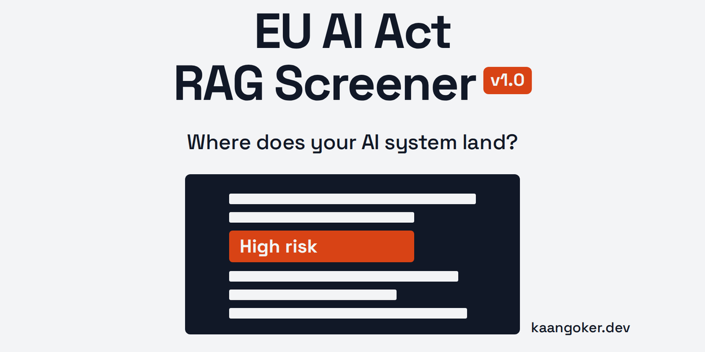
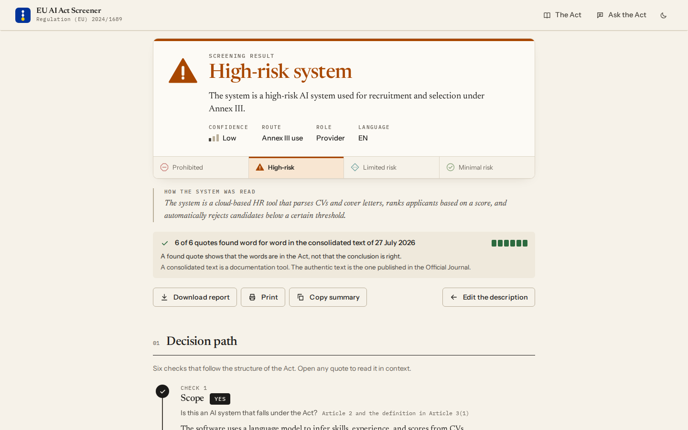
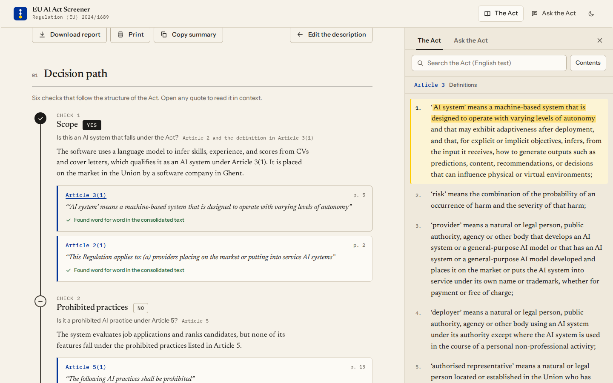
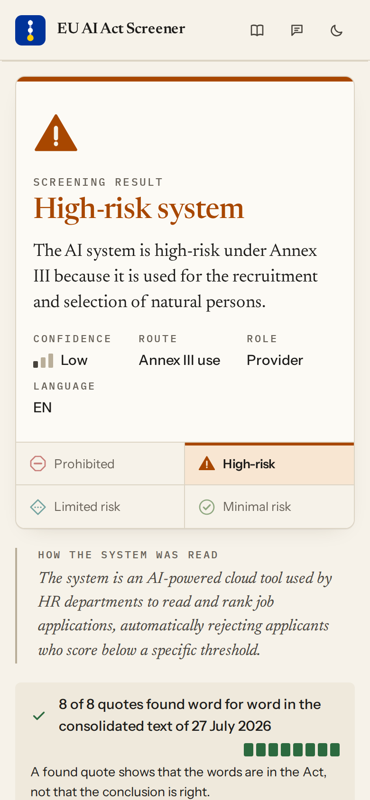
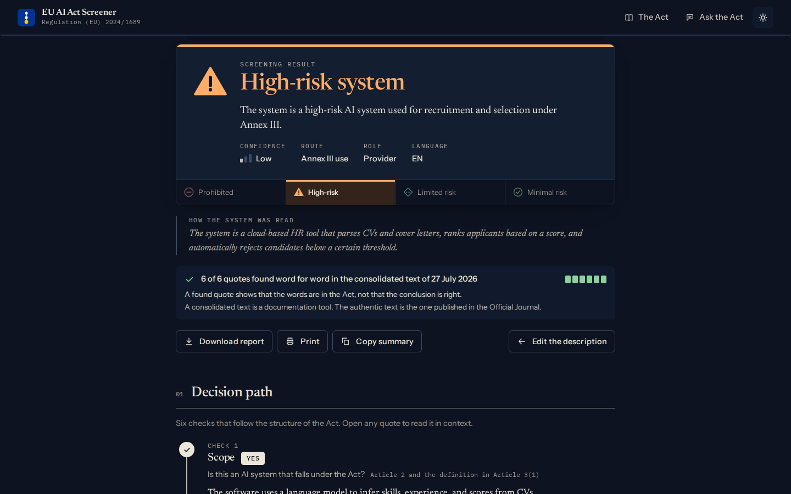

# EU AI Act Screener

[](https://huggingface.co/spaces/KaanGoker/eu-ai-act-rag-screener-demo)
[](https://github.com/KaanGoker/EU-AI-Act-RAG-Screener?tab=MIT-1-ov-file)

Describe an AI system and see where it lands under the EU AI Act, check by check, with every quote checked against the text of the Act.

<p align="center">
  
</p>

<h3 align="center">
  <a href="https://huggingface.co/spaces/KaanGoker/eu-ai-act-rag-screener-demo" target="_blank">Try the demo on Hugging Face</a>
</h3>

---

The EU AI Act (Regulation (EU) 2024/1689) is long, and in July 2026 the Digital Omnibus on AI changed parts of it. For a developer or a founder, finding out whether a system is prohibited, high-risk or only has transparency duties means hours of reading articles, annexes and exceptions.

**What it does.** You describe what your system does and say whether you build it or use it. The screener walks six checks in the order of the Act's provisions, quotes the articles it relies on and gives a draft risk class with the obligations and the dates that follow from it. Each quote opens in a reader with the full text of the Act, so you can read the provision yourself.

It is a draft screening for orientation, not legal advice. See [DISCLAIMER.md](DISCLAIMER.md).

**What changed since v0.1.** The first version was a Chainlit chat that answered with a risk tier and page links. This version is a new app, and the two are compared [below](#what-changed-since-v01).

<p align="center">
  
</p>

<p align="center">
  
</p>

---

## Features

-   **Six checks**: Scope, prohibited practices, high-risk, the Article 6(3) exemption, transparency duties and general-purpose AI. Each check has an outcome (yes, no, unclear, not reached), the reasoning and the quotes it rests on. The six checks are this tool's reading order; the Act does not prescribe such a checklist.
-   **Verified quotes**: Every quote the model gives is searched in the provision it cites, or in another paragraph of the same article or annex. A quote counts as found only when it is in that text exactly, after folding whitespace, quote marks, hyphens and letter case. A quote that is not found stays on the page with a flag.
-   **Class from fixed rules**: The model does not decide the class. The backend derives it from the six outcomes, the high-risk route and profiling, and a test runs all 61,440 combinations against those rules. The rules only make the class follow the steps; when the model gets a step wrong, the class is wrong too (see the measured results below).
-   **Obligations and dates from data files**: The obligations come from `data/obligations.json`, where every item is tied to its article; the model only picks item ids. The dates come from `data/timeline.json`, each with its source. Dates the model writes are replaced.
-   **Six results**: Prohibited, high-risk, limited risk, minimal risk, outside the Act, or unclear when the description does not allow a decision.
-   **Open questions**: The result lists the facts that would change it. Answer them and the screener runs again with your answers added.
-   **The Act beside the result**: The whole Act in a reader, with the quoted words highlighted, the provisions changed in 2026 marked, and a link to the page in the EUR-Lex PDF. Search and a table of contents work without any model call.
-   **Ask the Act**: Questions about the Act, answered from the text with citations that open in the reader. The answer streams.
-   **Report**: Download the result as Markdown, or print it. The server signs every result, so a report can only be made from a result it gave, unchanged.
-   **Your role**: Provider, deployer or not sure. The obligations follow the role.
-   **Several languages**: You can write the description in Dutch, French, German, Turkish or another language. The reasoning comes back in that language; the quotes stay in the English text of the Act.
-   **Themes**: Light and dark, and a layout for phones.
-   **Limits and privacy**: Per-IP and global rate limits and a daily budget. Nothing a user types is stored or logged. The demo keeps one number per day: how many times the page was opened.

<p align="center">
  
  &nbsp;
  
</p>

---

## What changed since v0.1

| | v0.1 Demo | This version |
| --- | --- | --- |
| Interface | Chainlit chat | Its own web page served by FastAPI: plain HTML, CSS and JavaScript, no build step |
| Text of the Act | The 2024 Official Journal PDF | The consolidated version of 27 July 2026, with the amendments of the Digital Omnibus on AI |
| Chunks | PDF pages cut into pieces of 4,000 characters | 313 articles, annexes and recitals, split into 699 paragraphs and points |
| Search | Vector search, top 5 | Hybrid: BM25 and vectors, merged with reciprocal rank fusion, top 8 |
| Embeddings | Gemini API (`gemini-embedding-001`) | A local model with fastembed, no API call |
| Model call | One free-text answer from `gemini-2.5-flash-lite` | One structured call that fills in six checks, on `gemini-3.5-flash-lite` with two fallback models |
| Risk class | Written by the model | Derived by the backend from the six outcomes |
| Sources | The retrieved chunks, each with a link to its PDF page | Quotes, each searched in the provision it cites and marked found or not found |
| Obligations and dates | None | From data files, each item tied to its article |
| Reading the Act | A link to the PDF | A reader beside the result, with search and a table of contents |
| Report | None | Markdown report made from a signed result |
| Limits | None | Per-IP and global rate limits, and a daily budget |
| Tests and evaluation | None | 488 tests, a labeled set of 52 cases and a retrieval set of 69 queries |

The full list of changes is in [CHANGELOG.md](CHANGELOG.md).

---

## How it works

The app is one FastAPI process. It serves a plain HTML, CSS and JavaScript page, with no framework and no build step.

1.  **Retrieve**: The description goes through hybrid search over the Act: BM25 and dense vectors in ChromaDB, merged with reciprocal rank fusion. The embeddings run locally with fastembed, so search and indexing make no API call. The eight best passages are added to a fixed set of provisions every screening needs, among them Articles 2, 3, 5, 6 and 50, Annex I and Annex III.
2.  **Reason**: One Gemini call with structured output fills in the six checks, the open questions and the obligation ids. If a model is out of quota or fails, the next model in the list takes over.
3.  **Verify**: Each quote is checked against the cited provision. A quote with an ellipsis is split, and each piece is checked on its own. A citation to a provision that was not in the context is dropped.
4.  **Decide**: The backend fixes the path (a missing or contradictory step becomes unclear), derives the class from the outcomes, and adds the obligations and dates from the data files.
5.  **Stream**: The page shows the stages while the result is built, then the signed result.

**What "verified" means.** A verified quote shows that these words are in the cited provision of the text the app holds. It does not show that the conclusion drawn from them is right: a correct quote can sit next to a wrong reading, and the class can still be wrong. The check runs against the app's own parsed copy of the consolidated text, which is a documentation tool; the authentic text is the one in the Official Journal. The tool also cannot see facts that are not in the description and does not cover national law. Its rules, data files and labels are my reading of the Act; no lawyer has reviewed them.

### The text of the Act

-   Articles and annexes come from the EUR-Lex consolidated version of 27 July 2026 of Regulation (EU) 2024/1689 (CELEX `02024R1689-20260727`), which includes the amendments of Regulation (EU) 2026/1744, the Digital Omnibus on AI.
-   The consolidated version has no recitals, so the recitals come from the 2024 Official Journal text.
-   `ingest/build_corpus.py` parses both PDFs by structure: 313 units (119 articles, 14 annexes, 180 recitals), split into paragraphs and points, each with its page number. Units and parts changed by the 2026 amendments are marked.
-   The sources behind the data files and the evaluation labels are listed in [docs/legal-sources.md](docs/legal-sources.md).

### Retrieval, measured

`eval/retrieval_eval.py` runs 69 queries: 51 in English and 18 in Dutch, French, German and Turkish. Some are system descriptions, some are questions about the Act, and some target provisions added in 2026. Each query lists the articles or annex points that must come back. The screener uses the top 8 hits, so recall@8 is the number that matters.

| Mode | Recall@5 | Recall@8 | MRR | Recall@8, English | Recall@8, other languages |
| --- | --- | --- | --- | --- | --- |
| BM25 | 0.594 | 0.638 | 0.494 | 0.863 | 0.000 |
| Dense | 0.899 | 0.906 | 0.673 | 0.941 | 0.806 |
| Hybrid | 0.913 | 0.928 | 0.665 | 0.971 | 0.806 |

The embedding model and a small query glossary (everyday words such as "chatbot" or "CV" mapped to the Act's own wording) were chosen while measuring on this same set, so these numbers are optimistic. BM25 alone runs without the glossary and finds nothing in the other languages.

### Evaluation set

`eval/cases.jsonl` holds 52 labeled system descriptions, each written for one provision: 9 prohibited, 16 high-risk, 9 limited risk, 9 minimal risk, 3 outside the Act, 4 unclear and 2 off-topic or prompt injection. 44 are in English, 2 each in Dutch, French, German and Turkish. `eval/run_eval.py` sends them to a running server and reports class accuracy, per-class scores, cited references, quote verification and latency. How the labels were made is in [eval/README.md](eval/README.md).

### Classification, measured

One run against the live Space on 12 November 2026, with `gemini-3.5-flash-lite` (one case was answered by the fallback model `gemini-3.1-flash-lite`) and the consolidated text of 27 July 2026:

| Metric | Value |
| --- | --- |
| Class accuracy | 84.6% (44 of 52) |
| Out of scope, precision / recall | 100.0% / 100.0% |
| General-purpose AI flag, accuracy | 100.0% |
| Expected article cited | 96.0% |
| Quotes found in the cited text | 273 of 285 (95.8%) |
| Latency per screening, mean | 9.2 s |

| Expected class | Precision | Recall | Cases |
| --- | --- | --- | --- |
| Prohibited | 88.9% | 88.9% | 9 |
| High-risk | 71.4% | 93.8% | 16 |
| Limited risk | 100.0% | 88.9% | 9 |
| Minimal risk | 87.5% | 77.8% | 9 |
| Outside the Act | 100.0% | 100.0% | 3 |
| Unclear | 100.0% | 25.0% | 4 |
| Off-topic or injection | 100.0% | 100.0% | 2 |

Five of the eight misses are descriptions that are underspecified or on a border, which the model placed in high-risk instead of unclear or minimal. Only 1 of the 4 unclear cases came back as unclear: in this run, the tool leaned toward high-risk when a fact was missing. The other three misses are an emotion recognition case in German (prohibited, read as high-risk), a reoffending risk tool (high-risk, read as prohibited) and an open-weight model with a paid API (limited risk, read as minimal).

The set is small: 52 cases, so one case moves the accuracy by about 2 points. The labels are my own reading of the Act, and no lawyer has reviewed them. This is one run of one model on one date. A screening takes about 9 seconds on the free CPU Space. The full results, the list of misses and the command to reproduce the run are in [eval/RESULTS.md](eval/RESULTS.md).

---

## Usage

### Run with Docker

```bash
git clone https://github.com/KaanGoker/EU-AI-Act-RAG-Screener.git
cd EU-AI-Act-RAG-Screener
docker build -t eu-ai-act-screener .
docker run -p 7860:7860 -e GOOGLE_API_KEY=your_key eu-ai-act-screener
```

Open `http://localhost:7860`. The image runs as a non-root user on port 7860, the same setup as the Hugging Face Docker Space. The embedding model is downloaded once during the build and stored in the image.

### Run locally

Python 3.12:

```bash
python -m venv .venv
source .venv/bin/activate
pip install -r requirements.txt
echo "GOOGLE_API_KEY=your_key" > .env
uvicorn app.main:app --port 7860
```

The corpus and the search index are in the repository. The first start downloads the embedding model (about 1.2 GB) into `models/`.

Without a key, the reader and the search work, and screening answers that it is not configured. To try the whole page without a key, start it in fake mode, which classifies by keyword rules:

```bash
SCREENER_FAKE_LLM=1 uvicorn app.main:app --port 7860
```

### Settings

The environment variables that matter most:

| Variable | Default | Meaning |
| --- | --- | --- |
| `GOOGLE_API_KEY` | none | Gemini API key |
| `GEMINI_MODEL` | `gemini-3.5-flash-lite` | First model |
| `GEMINI_FALLBACK_MODELS` | `gemini-3.1-flash-lite,gemini-2.5-flash-lite` | Tried in order when a model fails or is out of quota |
| `SCREENER_FAKE_LLM` | `0` | `1` for keyword rules instead of the model |
| `RATE_LIMIT_PER_MIN` | `6` | Screenings and questions per client IP per minute |
| `RATE_LIMIT_PER_DAY` | `60` | Screenings and questions per client IP per UTC day |
| `DAILY_BUDGET` | `900` | Screenings and questions for the whole app per UTC day |
| `REPORT_SECRET` | random per process | Key that signs results; set it so reports keep working after a restart |
| `STATS_TOKEN`, `STATS_REPO` | unset | Hugging Face token and private dataset for the daily visit count; without both, nothing is counted |
| `TRUSTED_PROXY_HOPS` | `1` | Proxies in front of the app that add to `X-Forwarded-For` |

All variables, the routes and the result format are in [docs/api.md](docs/api.md).

### Rebuild the corpus and the index

Only needed for a new version of the Act or a change to the parser. Put the two PDFs from EUR-Lex in `data/` if they are not there:

-   `data/eu_ai_act_consolidated_2026-07-27.pdf` from https://eur-lex.europa.eu/legal-content/EN/TXT/PDF/?uri=CELEX:02024R1689-20260727
-   `data/eu_ai_act.pdf` from https://eur-lex.europa.eu/legal-content/EN/TXT/PDF/?uri=OJ:L_202401689

Then:

```bash
pip install -r requirements-dev.txt
python -m ingest.build_corpus   # data/corpus.json, stops when counts or numbering are wrong
python -m ingest.build_index    # chroma_db/, rebuilt from scratch
```

### Tests and evaluation

```bash
pip install -r requirements-dev.txt
python -m pytest -q                                   # 488 tests, no API key needed; uses the embedding model
python eval/retrieval_eval.py                        # the retrieval table above
python eval/run_eval.py --base-url http://127.0.0.1:7860 --out eval/results/run-1.json
```

`run_eval.py` needs a running server. With the real model, the 52 cases count against the rate limits and the daily budget; [eval/README.md](eval/README.md) explains how to resume a run.

`tools/screenshots.py` takes the screenshots in this README from a running server (needs `python -m playwright install chromium`).

---

## Project structure

```
EU-AI-Act-RAG-Screener/
├── app/
│   ├── main.py          the routes, rate limits, streaming, signed results
│   ├── screener.py      the pipeline: context, prompt, quote checks, decision rules, obligations, dates
│   ├── verify.py        quote verification
│   ├── retrieval.py     hybrid search: BM25, fastembed vectors in ChromaDB, rank fusion
│   ├── ask.py           Ask the Act
│   ├── llm.py           Gemini calls, fallback models, timeouts
│   ├── corpus.py        the parsed Act: units, parts, labels, pages
│   ├── report.py        the Markdown report
│   ├── schemas.py       request and result models
│   ├── examples.py      the example systems on the page
│   ├── config.py        settings from the environment
│   └── static/          the page: index.html, css/, js/, fonts/
├── data/
│   ├── corpus.json      313 units of the Act
│   ├── obligations.json obligations by class and role, each tied to its article
│   ├── timeline.json    dates and their sources
│   └── *.pdf            the EUR-Lex PDFs the corpus is built from
├── chroma_db/           the dense index
├── ingest/              build_corpus.py, build_index.py
├── eval/                retrieval_eval.py, cases.jsonl, run_eval.py
├── tests/               unit and API tests
├── tools/screenshots.py README screenshots
├── docs/                api.md, legal-sources.md
├── deploy/space/        the Hugging Face Space card
├── assets/              cover and screenshots
├── Dockerfile
├── requirements.txt
└── requirements-dev.txt
```

---

## Data sources and licenses

-   **The Act**: Text from [EUR-Lex](https://eur-lex.europa.eu), © European Union, 1998-2026. EUR-Lex allows reuse under the Commission's reuse policy, Decision 2011/833/EU, and licenses consolidated texts under [CC BY 4.0](https://creativecommons.org/licenses/by/4.0/) ([legal notice](https://eur-lex.europa.eu/content/legal-notice/legal-notice.html)). Changes made here: the text is split into articles, annexes, recitals, paragraphs and points; page headers, footers, footnotes and consolidation markers are removed; long dashes are written as hyphens. Only the texts published in the Official Journal of the European Union are authentic.
-   **Embedding model**: EmbeddingGemma 300M by Google, in the ONNX build [`onnx-community/embeddinggemma-300m-ONNX`](https://huggingface.co/onnx-community/embeddinggemma-300m-ONNX), loaded through fastembed. It is not in this repository; it is downloaded on first use. Gemma is provided under and subject to the Gemma Terms of Use found at [ai.google.dev/gemma/terms](https://ai.google.dev/gemma/terms), with the [Gemma Prohibited Use Policy](https://ai.google.dev/gemma/prohibited_use_policy).
-   **Fonts**: Newsreader, Instrument Sans and IBM Plex Mono, under the SIL Open Font License 1.1. The license files are in `app/static/fonts/`.
-   **Gemini**: Screening and Ask the Act send text to the Google Gemini API, under the [Gemini API Additional Terms of Service](https://aistudio.google.com/docs/terms).

## Disclaimer

This tool gives a draft screening for orientation. It is not legal advice, the class can be wrong, and a verified quote does not make the conclusion right. You must be 18 or older to use it. Do not paste personal or confidential data. Read [DISCLAIMER.md](DISCLAIMER.md) before you use it.

## License

This project is licensed under the MIT License. See the [LICENSE](LICENSE) file for details. The Act text, the embedding model and the fonts keep their own licenses, listed above.
